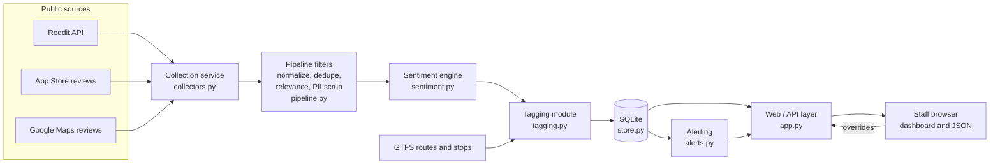

# System Architecture

## 1. Architectural Style
- Pattern: Modular monolith with a pipes-and-filters processing pipeline, served through a layered web application (presentation, web/API, domain modules, data access).
- Rationale: The team is four part-time students with about 288 person-hours and free-tier hosting only. One deployable container is simpler to build, test and demo than separate services. The nightly batch work (collect, clean, score, tag) is a fixed sequence of independent steps, which is what pipes and filters suits: each filter can be tested alone and swapped (for example, replacing the lexicon sentiment baseline with a trained model) without changing the others. Module boundaries match the WBS deliverables (1.5 collection, 1.6 sentiment, 1.7 tagging, 1.8 dashboard), so a module can be split into its own service later if load requires it.

## 2. Component Interaction Diagram (Mermaid)

## 3. Data Flow & Execution Lifecycle
1. Ingestion: A collection cycle starts when the container starts (and, in deployment, from a nightly scheduled run of `python -m trfd.pipeline` that must finish before 06:00). Each connector pulls new public posts and reviews from its source and returns raw records.
2. Processing: Records are normalized into one format that keeps only text, timestamp and source (author fields are dropped). Cross-source duplicates are removed by a text fingerprint, off-topic Reddit posts are discarded, and usernames, emails and phone numbers are replaced with placeholders. The sentiment engine adds a label and confidence score, and the tagging module adds route, stop and issue category. Items with no resolvable route or stop are flagged for the manual tagging queue instead of being guessed.
3. Persistence & Response: Clean records are written to SQLite. The alerting module checks negative volume per route against the threshold. The Flask layer answers dashboard and API requests with filtered queries and aggregates. Staff overrides update the record and are written to `override_log` with the old value, so they can be used for retraining.

## 4. Architecture Decision Records (ADRs)
- ADR-01 (Modular monolith in one container): Context: small part-time team, fixed course deadlines, free-tier hosting. Chosen: one Flask application with separate modules per WBS deliverable. Trade-off accepted: modules cannot be scaled or deployed independently, and one failing module can stop the whole app.
- ADR-02 (SQLite for the prototype): Context: zero setup is needed for the demo and the data volume is small. Chosen: SQLite file inside the container. Trade-off accepted: single writer, and data is lost when the container is removed unless a volume is mounted. PostgreSQL is the planned replacement for deployment.
- ADR-03 (Lexicon baseline before a trained model): Context: the 500-item validation set is labelled by the team and no training data exists at the start of construction. Chosen: an explainable lexicon classifier with negation and sarcasm rules behind a single `score()` function. Trade-off accepted: lower accuracy on slang; if it misses the 80% agreement target it is replaced by a trained model behind the same interface.
- ADR-04 (Official APIs only, sample-data mode for the demo): Context: Reddit API access needs approval and Google Maps returns at most five reviews per place. Chosen: connectors use only official APIs within published rate limits, and the prototype reads a synthetic sample file. Trade-off accepted: the demo does not show live data.
- ADR-05 (Scrub personal data before storage): Context: the dashboard is seen by agency staff and the scope statement requires that usernames, handles and contact details never be stored. Chosen: PII scrubbing runs in the pipeline before any write. Trade-off accepted: a removed handle cannot be recovered to follow up with a rider.
- ADR-06 (Manual queue for unresolved locations): Context: vague feedback ("the bus at the downtown station") cannot be tied to a route reliably. Chosen: route and stop resolution against GTFS, with unresolved items flagged for staff tagging. Trade-off accepted: extra manual work for customer service staff.
